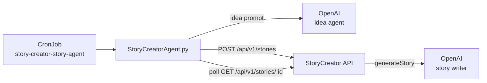

# Story Automation Agent

StoryCreator can create a complete bilingual story on a schedule without a human
in the loop. A Kubernetes CronJob runs `DialectHubAgent/StoryCreatorAgent.py`,
which invents a random beginner-friendly idea, sends it to the public API, and
waits for the AI writer to finish.



---

## Components

| Path | Purpose |
|---|---|
| `DialectHubAgent/StoryCreatorAgent.py` | Idea generation, API client, status polling, CLI |
| `DialectHubAgent/requirements.txt` | `openai-agents`, `openai`, `httpx` |
| `pythonDockerBaseImage/Dockerfile` | Builds the `storycreator-scripts` image (non-root, Python 3.14 Alpine) |
| `helm/story-creator/templates/story-creator-agent-cronjob.yaml` | Kubernetes CronJob (`<release>-story-agent`) |
| `helm/story-creator/values.yaml` | `storyCreatorAgent.*`, `image.scripts.*`, `resources.storyCreatorAgent` |
| `.github/workflows/ci-cd.yml` | Builds and pushes `charly37/storycreator-scripts` on every push |

The agent uses the **public API**, not MongoDB. That means every generated story
goes through the same validation, rate limiting, serializer and generation
pipeline as stories created on the website.

---

## Prerequisites

1. **Write-enabled API key**
   - Log in as an account with creator access.
   - Go to **Profile → API keys**, click **Create API key**, enable
     **"Allow creating stories (uses AI)"**, and copy the key (shown once).
   - The key has the scopes `stories:read` and `stories:write`.

2. **OpenAI key** for the idea agent (`OPEN_AI_KEY` or `OPENAI_API_KEY`).

3. **Secret in the cluster**
   - `story-creator-secrets` must contain `storycreator-api-key` (the key above)
     and `open-ai-key` (also used by the app for story generation).

   ```bash
   kubectl -n story-creator patch secret story-creator-secrets --type merge \
     -p '{"stringData":{"storycreator-api-key":"stc_live_..."}}'
   ```

4. **Scripts image** published by CI (`charly37/storycreator-scripts`).

---

## How a run works

1. The agent picks a random theme, protagonist and plot twist
   (for example *"transport in the city"*, *"an elderly neighbour"*,
   *"a lost object that turns up in an unexpected place"*).
2. An OpenAI agent returns JSON with `title_native`, `title_learning`, `theme`,
   `vocabulary` (8–12 beginner words), up to three characters, and a `seed`.
3. The agent appends the target vocabulary and level instructions to the seed and
   POSTs to `/api/v1/stories` with `published` (default `true`), chapter specs and
   the cast.
4. The API creates a draft and starts AI generation asynchronously, returning
   `202` with the story id.
5. The agent polls `GET /api/v1/stories/:id` every 5 seconds. Because the key has
   `stories:write`, the response includes a `status` block for the owner:
   - `generating` → keep polling
   - `ready` → log the title, chapter count and sentence count
   - `failed` → log `generationError` and exit non-zero
6. If `published` was requested, the server publishes the story as soon as
   generated content exists.

---

## Local usage

```bash
cd DialectHubAgent
pip install -r requirements.txt

export OPEN_AI_KEY=sk-...
export STORYCREATOR_API_KEY=stc_live_...
export STORYCREATOR_API_URL=http://localhost:3000

# Generate the idea and print the API request without calling the API
python StoryCreatorAgent.py --dry-run

# Create and publish a 3-chapter story
python StoryCreatorAgent.py --chapters 3 --sentences-per-chapter 8 --output story.json
```

`--dry-run` requires `OPEN_AI_KEY` but not `STORYCREATOR_API_KEY`.

### CLI reference

| Option | Default | Description |
|---|---|---|
| `--api-url` | `$STORYCREATOR_API_URL` or `http://localhost:3000` | StoryCreator base URL |
| `--api-key` | `$STORYCREATOR_API_KEY` | Write-enabled API key |
| `--level` | `beginner` | `beginner`, `intermediate` or `advanced` |
| `--native-language` | `en` | Native language code (use `fr` for French learners) |
| `--learning-language` | `pt` | Learning language code |
| `--learning-language-name` | `European Portuguese` | Name used in the seed prompt |
| `--theme` | random | Force a theme instead of picking one at random |
| `--chapters` | `3` | 1–10 chapters |
| `--sentences-per-chapter` | `8` | 1–100 target sentences per chapter |
| `--model` | `gpt-4.1-mini` | Model used to invent the idea |
| `--ai-model` | server default | Model used by the server to write the story (`gpt-4o-mini`, `gpt-4.1-mini`, `gpt-4o`, `gpt-5-mini`) |
| `--no-publish` | — | Keep the story as a draft |
| `--idempotency-key` | generated | Reuse a key when retrying |
| `--poll-interval` | `5` | Seconds between status polls |
| `--timeout` | `900` | Max seconds to wait for generation |
| `--output` | — | Write idea, request and story to a JSON file |
| `--dry-run` | — | Print the request and exit without calling the API |

### Environment variables

| Variable | Required | Description |
|---|---|---|
| `STORYCREATOR_API_KEY` | yes | Key with `stories:write` |
| `STORYCREATOR_API_URL` | no | API base URL (default `http://localhost:3000`) |
| `OPEN_AI_KEY` | yes | OpenAI key for the idea agent (`OPENAI_API_KEY` also accepted) |
| `STORYCREATOR_IDEMPOTENCY_KEY` | no | Stable retry key; the CronJob sets it to the Job name |

---

## Docker image

Built from the repository root (the CI workflow does this on every push):

```bash
docker build -t storycreator-scripts:dev -f pythonDockerBaseImage/Dockerfile .
```

Run it:

```bash
docker run --rm \
  -e STORYCREATOR_API_URL=https://bilingualstory.net \
  -e STORYCREATOR_API_KEY=stc_live_... \
  -e OPEN_AI_KEY=sk-... \
  storycreator-scripts:dev \
  --chapters 3 --sentences-per-chapter 8
```

The container runs as UID 1000 (`appuser`) and has no writable application
directory requirement; the agent only needs network access. `python -u
StoryCreatorAgent.py` is the image entrypoint, so CLI flags are appended directly
after the image name.

---

## Helm CronJob

The chart renders the CronJob only when `storyCreatorAgent.enabled` is true
(default). Resource name: `<release>-story-agent`; with the documented release
name that is `story-creator-story-agent`.

### Values

```yaml
image:
  tag: latest            # also used by the scripts image
  scripts:
    repository: charly37/storycreator-scripts
    tag: ""              # empty = image.tag
    pullPolicy: IfNotPresent

storyCreatorAgent:
  enabled: true
  schedule: "0 8 * * 1"  # Mondays 08:00, cluster timezone
  suspend: false
  startingDeadlineSeconds: 300
  successfulJobsHistoryLimit: 3
  failedJobsHistoryLimit: 3
  backoffLimit: 2
  activeDeadlineSeconds: 1200
  apiUrl: ""             # empty = http://<release>-app
  apiKeySecret:
    name: story-creator-secrets
    key: storycreator-api-key
  args:
    - "--level"
    - "beginner"
    - "--chapters"
    - "3"
    - "--sentences-per-chapter"
    - "8"

resources:
  storyCreatorAgent:
    requests: { memory: "64Mi", cpu: "50m" }
    limits:   { memory: "256Mi", cpu: "250m" }
```

The scripts image tag defaults to `image.tag`, so `--set image.tag=<sha>` (or a
release deploy) updates the app and the agent together.

### Common operations

```bash
# Trigger a run now
kubectl -n story-creator create job \
  --from=cronjob/story-creator-story-agent story-agent-manual

# Follow job/pod status
kubectl -n story-creator get jobs,pods -l app=story-creator-story-agent --watch

# Read the agent logs
kubectl -n story-creator logs job/story-creator-story-agent-<timestamp>

# Temporarily stop scheduled runs
helm upgrade story-creator helm/story-creator --reuse-values \
  --set storyCreatorAgent.suspend=true

# Create drafts instead of publishing
helm upgrade story-creator helm/story-creator --reuse-values \
  --set storyCreatorAgent.args='{--no-publish}'
```

### Idempotency and retries

The CronJob injects the pod's `job-name` label as
`STORYCREATOR_IDEMPOTENCY_KEY`. Kubernetes retries (`backoffLimit`) reuse it, so
a retry after a crash or API timeout returns the **existing** story instead of
starting a second paid AI generation. A new scheduled run gets a new Job name and
therefore a new story.

If `--idempotency-key` is passed explicitly, it takes precedence over the
environment variable.

---

## Cost and limits

- Each run makes **two paid OpenAI calls**: one to invent the idea, one on the
  server to write the story.
- The server has no daily quota. The only API throttle is the per-key rate limit
  (`PUBLIC_API_RATE_LIMIT_PER_MIN`, default 60 requests/minute), which is not a
  meaningful brake for a scheduled job. Choose the schedule deliberately.
- Story size is controlled by `--chapters` and `--sentences-per-chapter`; more
  chapters/sentences mean larger prompts and higher cost.
- Generation runs inside the API process, not the CronJob pod. If the API pod is
  restarted while generating, the story may remain marked `generating`; retrying
  the run with the same Idempotency-Key waits on that story rather than creating
  another one.

---

## Troubleshooting

| Symptom | Cause / fix |
|---|---|
| Pod stuck in `CreateContainerConfigError` | `storycreator-api-key` or `open-ai-key` missing from `story-creator-secrets` |
| `403 INSUFFICIENT_SCOPE` | The key was created without "Allow creating stories". Revoke it and create a new write-enabled key |
| `403 CREATOR_ACCESS_REQUIRED` | The key owner no longer has `canCreateStories`; restore creator access or use another account |
| `401 INVALID_API_KEY` | The key was revoked/deleted, or the secret holds a different key |
| `Story generation failed: 401 Incorrect API key` | The **server's** `OPEN_AI_KEY` (not the agent's) is missing or invalid |
| `Story generation failed: …` | The server recorded `generationError`; fix the upstream issue and run the job again |
| Job exits with a timeout | Increase `storyCreatorAgent.activeDeadlineSeconds` (must exceed `--timeout`, default 900s) and optionally `--timeout` |
| `ImagePullBackOff` | The scripts image tag was not pushed. Set `image.scripts.tag` or `image.tag` to a tag that exists in Docker Hub |
| `502`/connection refused | `storyCreatorAgent.apiUrl` is wrong or the app Service is not ready; the default is `http://<release>-app` |

Related documentation: [Public API v1](PUBLIC_API.md) · [Setup](SETUP.md) · [Design](design.md)
