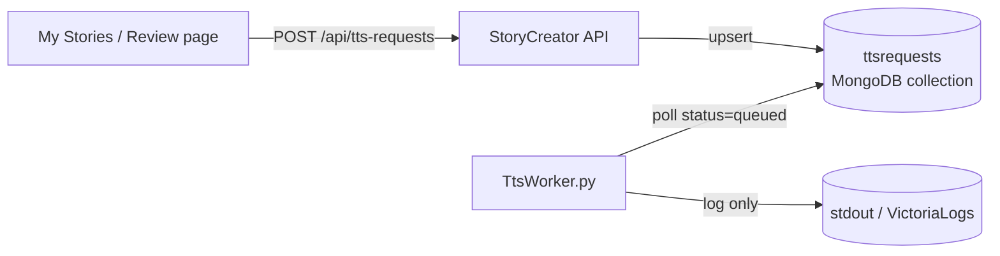

# Text-to-Speech Queue Worker

StoryCreator can queue narrated audio for a story. The request is stored in MongoDB and picked up by
`TtsWorker/TtsWorker.py`, a long-running worker deployed alongside the app.

> **Step 1 — framework only.** The worker currently *watches* the queue and logs what is waiting. It
> does not call any speech service, does not write files, and never modifies the database. Audio
> synthesis, file storage, progress and playback come in a later step.



---

## Components

| Path | Purpose |
|---|---|
| `src/models/TtsRequest.ts` | Queue document — one per `(story, language)` |
| `src/routes/tts.ts` | `POST /api/tts-requests`, `GET /api/tts-requests?storyIds=…` |
| `TtsWorker/TtsWorker.py` | Queue watcher (read-only in step 1) |
| `TtsWorker/requirements.txt` | `pymongo` |
| `pythonDockerBaseImage/Dockerfile` | Ships the worker in the `storycreator-scripts` image |
| `helm/story-creator/templates/tts-worker-deployment.yaml` | Deployment (`<release>-tts-worker`) |
| `helm/story-creator/values.yaml` | `ttsWorker.*`, `resources.ttsWorker` |
| `src/client/utils/ttsRequests.ts` | Browser helpers for requesting and reading status |

Unlike the [story agent](STORY_AGENT.md), this worker talks **directly to MongoDB** — it needs the
whole queue, not one story, and the public API exposes no queue endpoint.

---

## What a request looks like

One document per story and language, so a bilingual story produces two entries (`lang1`, `lang2`):

```json
{
  "_id": "ObjectId('...')",
  "storyId": "ObjectId('...')",
  "lang": "lang1",
  "status": "queued",
  "requestedBy": "ObjectId('...')",
  "attempts": 0,
  "error": "",
  "requestedAt": "2026-11-15T10:04:11.000Z",
  "createdAt": "2026-11-15T10:04:11.000Z",
  "updatedAt": "2026-11-15T10:04:11.000Z"
}
```

The unique index on `{ storyId, lang }` means requesting the same pair twice re-queues the existing
document instead of inserting a duplicate — which is exactly the behaviour wanted for "generate
again" once synthesis exists.

---

## How to request audio

1. Log in as the story's author on an account with creator access.
2. Open **My Stories** and click **Request audio** on a story with at least one sentence, or open a
   story's **Review** page and use the same button in the action row.
3. The story gains an "Audio queued" chip. Both languages are queued by default.

The UI calls `POST /api/tts-requests` with `{ storyId }`. See [API.md](API.md#text-to-speech-requests--api-tts-requests).

---

## Environment variables

| Variable | Required | Default | Notes |
|---|---|---|---|
| `MONGODB_URI` | yes | — | Same connection string as the app (`story-creator-secrets` / `mongodb-uri`) |
| `POLL_INTERVAL` | no | `5` | Seconds between queue polls |
| `LOG_LEVEL` | no | `info` | Accepts pino-style (`info`, `warn`, `error`) or Python-style (`INFO`, `WARNING`) names |

CLI flags `--mongo-uri`, `--poll-interval` and `--once` override the environment variables, mirroring
`StoryCreatorAgent.py`.

---

## Running locally

```bash
pip install -r TtsWorker/requirements.txt
MONGODB_URI="mongodb+srv://..." python -u TtsWorker/TtsWorker.py
```

Expected output when a request is waiting (one line per request, then silence — the worker remembers
what it has already reported):

```
INFO Watching collection ttsrequests every 5s (read-only; no audio generation yet)
INFO Found TTS request 6731... for story 6730... (lang1), queued at 2026-11-15 10:04:11+00:00
INFO Found TTS request 6731... for story 6730... (lang2), queued at 2026-11-15 10:04:11+00:00
```

Use `--once` for a single poll (smoke tests, or `kubectl exec` into a running pod).

Inspect the queue directly:

```bash
mongosh "$MONGODB_URI" --eval 'db.ttsrequests.find({status:"queued"}).sort({requestedAt:1}).pretty()'
mongosh "$MONGODB_URI" --eval 'db.ttsrequests.countDocuments({status:"queued"})'
```

Confirm the worker is truly read-only by re-reading the document after a poll — `status` must still
be `queued` and `updatedAt` must be unchanged.

---

## Building the image

The worker is packaged in the existing scripts image; no new image is built.

```bash
docker build -t storycreator-scripts:dev -f pythonDockerBaseImage/Dockerfile .
```

The image entrypoint stays `StoryCreatorAgent.py`, so the Deployment passes
`command: ["python", "-u", "TtsWorker.py"]` to override it — the same technique the story-agent
CronJob uses.

---

## Deploying

`ttsWorker.enabled` defaults to `false`, so installing the chart changes nothing until it is turned on:

```bash
# Enable the worker
helm upgrade story-creator helm/story-creator \
  --set ttsWorker.enabled=true \
  --set image.tag=dev-abc1234

# Check it started and is polling
kubectl -n story-creator get deploy story-creator-tts-worker
kubectl -n story-creator logs deploy/story-creator-tts-worker -f
```

| Value | Default | Notes |
|---|---|---|
| `ttsWorker.enabled` | `false` | Creates the Deployment |
| `ttsWorker.pollInterval` | `5` | Seconds between polls |
| `ttsWorker.logLevel` | `info` | Passed through as `LOG_LEVEL` |
| `ttsWorker.mongoSecret.name` / `.key` | `story-creator-secrets` / `mongodb-uri` | Source of `MONGODB_URI` |

`MONGODB_URI` is normally not stored in the chart: `kubectl create secret generic story-creator-secrets`
provisions it once alongside `session-secret` and the API keys.

**Keep the replica count at 1.** The step-1 worker does not claim jobs, so two pods would report the
same request twice. Claiming (a conditional `findOneAndUpdate` plus a heartbeat) arrives with
synthesis and makes additional replicas safe.

---

## Troubleshooting

| Symptom | Cause |
|---|---|
| `MONGODB_URI is not set` and exit code `1` | Secret key missing, or the Deployment env was overridden |
| Worker logs nothing | No documents with `status: "queued"` — check with `mongosh` |
| Same request logged once after every restart | Expected: the "already reported" set lives in memory only |
| Pod in `CrashLoopBackOff` | Connection string unreachable — check the secret and egress rules |
| Requests queued but never claimed | Expected in step 1; the worker is read-only by design |

Related documentation: [API](API.md) · [Design](design.md) · [Story Agent](STORY_AGENT.md) · [Logging](LOGGING.md)
